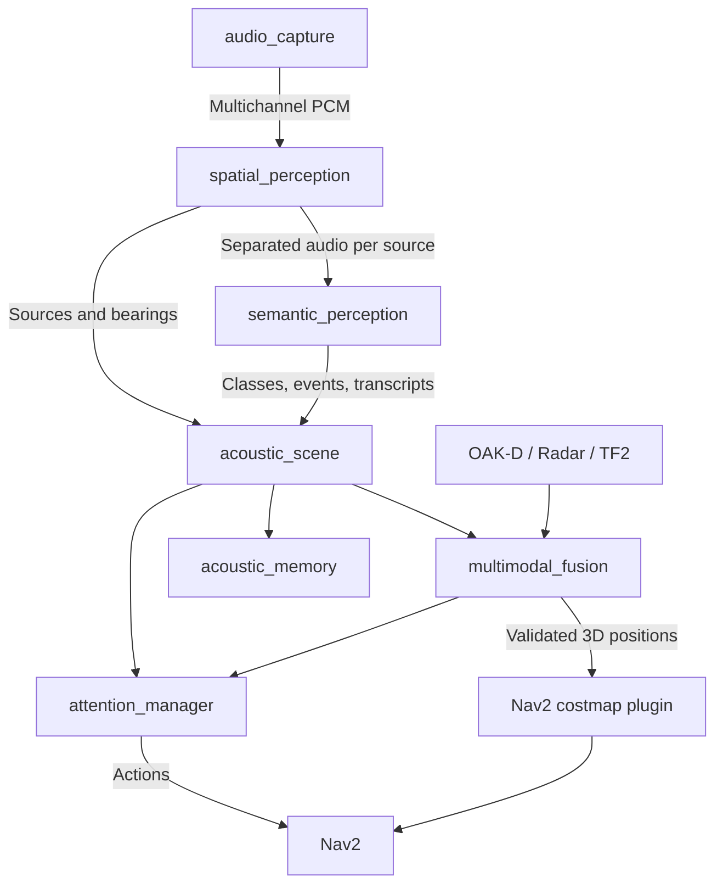

# audition_ros2

ROS 2 integration and robot-facing acoustic perception built on [libaudition](https://github.com/ARDev1161/libaudition).

**Status:** M0 interfaces, M1 WAV/ALSA capture and opt-in ODAS, and M2 YAMNet, Sherpa VAD + whisper.cpp adapters a strict no-ODAS mono route and opt-in validated M2c startup profiles are implemented. CI checks deterministic transport and native integration, **not model accuracy or physical ReSpeaker calibration**. Attention, fusion and navigation are future work.

## Interaction overview



[Static SVG version](docs/images/acoustic_interaction_flow.svg)

The M1 perception path has three ROS nodes: `audio_capture`, `spatial_perception`, and `acoustic_scene`. M2 adds `semantic_perception`; later components add attention, fusion and memory. A Nav2 costmap layer is a plugin, not an additional ROS node.

[Editable Mermaid diagram](docs/diagrams/acoustic_interaction_flow.mmd) · [Node responsibilities and interaction contracts](docs/ROS2_ARCHITECTURE.md)

## Documentation

The canonical Sphinx documentation, roadmap and user configuration guide live in the [independent `documentation` branch](https://github.com/ARDev1161/audition_ros2/tree/documentation). It is an orphan branch without ROS sources or code history.


- [libaudition integration and user configuration](docs/LIBAUDITION_INTEGRATION.md) — backend selection, proposed YAML presets, exposed ROS features and runtime configuration rules.
- [Node architecture and interaction contracts](docs/ROS2_ARCHITECTURE.md) — how many nodes, who owns data, internal/public topics, process isolation, QoS and lifecycle.
- [M0 implementation notes](docs/M0_IMPLEMENTATION.md) — implemented messages, example ReSpeaker profile, build and pending gates.
- [Engineering roadmap](docs/ROADMAP.md) — near-term ROS 2 integration, future capabilities, dependencies, explicit non-goals, validation gates, and safety boundaries.
- [Human spatial hearing and robot perception](docs/HUMAN_SPATIAL_HEARING.md) — how biological hearing uses acoustic cues, motion, vision, and prior knowledge; what is worth reproducing in robotics and where engineering alternatives are preferable.

## Experimental M1 WAV replay

With ROS 2 Humble installed:

```bash
source /opt/ros/humble/setup.bash
colcon build --symlink-install --cmake-args -DBUILD_TESTING=ON
source install/setup.bash
ros2 launch audition_bringup m1_wav_pipeline.launch.py wav_path:=/absolute/path/to/audio.wav
# New sourced shell:
ros2 topic echo /audition/scene audition_msgs/msg/AcousticScene --once
```

Only uncompressed PCM16 and normalized float32 RIFF/WAV are currently supported. The spatial backend is explicitly **disabled**: it produces empty source observations, not fake DOA measurements. This runs transport and scene-adapter plumbing rather than a functional source localization pipeline.

An optional `spatial_backend:=odas` mode is available with an ODAS-enabled libaudition CMake installation and separately calibrated array YAML. See [M1 implementation and native ODAS setup](docs/M1_IMPLEMENTATION.md).

## Experimental M2 semantic perception

Build/install libaudition with `LIBAUDITION_WITH_YAMNET=ON`, then enable `AUDITION_ROS2_WITH_SEMANTIC=ON` and `AUDITION_ROS2_WITH_YAMNET=ON` during the ROS build. Copy [the fail-closed M2 YAML template](audition_bringup/config/semantic_m2.yaml) to a user configuration file and provide a compatible **waveform-input YAMNet ONNX model**, its **521-class label map**, and `classifier_backend: yamnet`.

```bash
ros2 launch audition_bringup m2_wav_pipeline.launch.py \
  wav_path:=/path/to/six-channel.wav \
  spatial_backend:=odas \
  spatial_config:=/path/to/calibrated_microphones.yaml \
  semantic_config:=/path/to/semantic_yamnet.yaml
```

When spatial separation is available, ROS 2 exposes `/audition/classifications`, `/audition/events` and `/audition/scene`. The inference worker is provided by libaudition and receives per-source mono 16 kHz PCM. Threshold hysteresis and event transitions are also provided by libaudition, not reimplemented here. The default YAML disables inference; no model weights are bundled. The independent mono route is available with `spatial_backend:=mono` for one-channel 16 kHz capture and never fabricates direction.

See the [M2 implementation guide](https://github.com/ARDev1161/audition_ros2/blob/documentation/docs/M2_IMPLEMENTATION.md).

### Optional Russian speech recognition

Build `libaudition` with `LIBAUDITION_WITH_SHERPA=ON` and
`LIBAUDITION_WITH_WHISPERCPP=ON` (compatible installed whisper.cpp), and
build this ROS package with `AUDITION_ROS2_WITH_SEMANTIC=ON` and
`AUDITION_ROS2_WITH_SPEECH=ON`. Copy
[`semantic_m2.yaml`](audition_bringup/config/semantic_m2.yaml) and set
`speech_enabled: true`, `speech_vad_model`, `speech_asr_model`, and
`speech_language: ru`. Use the same M2 launch command with
`semantic_config:=/path/to/your.yaml`.

The speech adapter is part of `semantic_perception` (not a fifth ROS node).
Native `PerSourceSpeechRuntime` owns VAD segmentation and an asynchronous
Whisper ASR worker. The canonical `acoustic_scene` republishes accepted final
results to `/audition/transcripts`. No models are distributed, no transcripts
are fabricated when disabled, and a source ID is **not** a speaker identity.

See the [Sphinx speech setup and limitations](https://github.com/ARDev1161/audition_ros2/blob/documentation/docs/SPEECH_ASR.md).
For one-microphone speech without ODAS, use:
```bash
ros2 launch audition_bringup m2_wav_pipeline.launch.py \
  wav_path:=/absolute/path/to/mono-16k.wav spatial_backend:=mono \
  semantic_config:=/absolute/path/to/speech.yaml
# Or live ALSA: m2_alsa_pipeline.launch.py device:=hw:1,0 \
#   channel_count:=1 sample_rate_hz:=16000 spatial_backend:=mono
```
The mono router publishes one capture-stream source (not a speaker), with no
direction, range or position. Its source generation advances on capture
sequence loss, clock regression, excessive timestamp gaps or device-frame
change. Invalid formats fail closed; there is no implicit resampling or
downmixing. Real hardware and Russian recognition accuracy remain untested.

## Intended boundaries

- **libaudition:** application-independent C++17 DSP, spatial acoustic estimation, classification, speech processing, source identity, and temporal analysis.
- **audition_ros2:** ROS 2 capture adapters, scheduling, interfaces, transforms, diagnostics, and acoustic-scene publication.
- **Robot applications:** perception fusion, active investigation, navigation, planning, and safety policies.

The presence of an acoustic event or an estimated direction does not establish a physical obstacle or a metric source position. See both design documents before implementing navigation integration.

Target baseline for initial design: ROS 2 Humble and Nav2, with cross-distribution compatibility considered where practical. Hardware-specific accuracy, latency, and reliability are **not yet validated**.


## M2c validated startup profiles (opt-in)

For model-free mono replay:

~~~bash
ros2 launch audition_bringup m2_profile.launch.py \
  profile:=replay_ci wav_path:=/absolute/path/to/mono-16k.wav
ros2 service call /audition/semantic_perception/get_capabilities \
  audition_msgs/srv/GetCapabilities "{}"
~~~

Built-in profiles: mono_speech, replay_ci, spatial_events and robot_full.
The ODAS profiles deliberately fail until real microphone geometry is
provided; no model is automatically downloaded or enabled. The typed
capability service reports compiled/active semantic stages. Semantic ROS
parameters are startup-only and rejected on hot update to avoid stale native
workers. See [M2c configuration, validation and limitations](docs/M2_PROFILE_CONFIGURATION.md).
