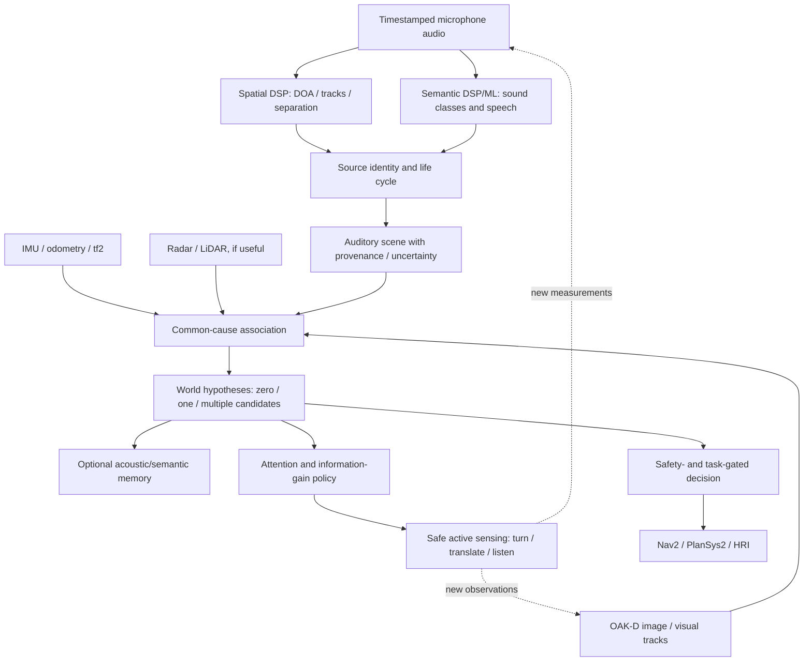

# Human Spatial Hearing and Robot Perception: Mechanisms, Analogies and Engineering Choices

**Status:** Technical background and architecture recommendation  
**Updated:** 2026-10-24  
**Companion:** [audition_ros2 Engineering Roadmap](ROADMAP.md)  
**Question:** How do people orient in an acoustic environment, correlate sound with other senses, and which principles should a ROS 2 robot reproduce—or deliberately replace with more reliable engineering methods?

## Executive conclusion

**Copy useful computational principles, not human anatomy or assumed brain modules.** Human spatial hearing provides good design ideas: parallel identification and localization, temporal grouping, stable auditory objects, multisensory causal association, active sensing, selective attention, self-motion compensation and memory. It does *not* establish that a robot needs two ear-like microphones, a biological cochlea, a neural imitation of auditory cortex, or a single opaque model that makes navigation decisions.

Recommended robot design: **physically grounded multichannel DSP + source-local ML + explicit probabilistic hypotheses + timestamped multimodal association + active perception and safety-gated actions**. Keep its interfaces auditable, replaceable and capable of abstaining.

The scientific mechanisms below describe supported principles, not a claim that human auditory neural computation is completely understood. The engineering mappings are architectural proposals and must be tested on the actual platform.

## 1. What does human hearing actually estimate?

The eardrums measure time-varying pressure, not ready-made objects or coordinates. Each ear receives a complex acoustic mixture filtered by the listener's head/body, the room, source directivity and motion. The auditory system infers perceptual *objects* from spectrotemporal regularities and integrates contextual evidence [1,2].

Useful distinctions:

1. **Sensation:** a waveform and its spectrotemporal structure.
2. **Feature extraction:** temporal delays, level/spectral differences, onset, pitch, harmonicity, timbre, modulation.
3. **Source organization:** which parts of a mixture probably belong together and persist over time.
4. **Spatial estimation:** direction, motion and coarse/uncertain distance.
5. **Association:** whether sound and visual/tactile/self-motion observations have a common cause.
6. **Attention and action:** select a relevant hypothesis, move, look, listen again or ignore it.
7. **Memory:** retain useful context and recognize familiar patterns.

This is a *functional* decomposition, not a one-to-one mapping of distinct brain regions to software packages. The interaction of cortical streams and feedback remains an active research subject [2].

## 2. Acoustic direction cues

### 2.1 Interaural time difference (ITD)

Sound generally reaches the nearer ear earlier. The delay depends on source direction, head geometry and frequency. Humans use interaural temporal cues especially at lower frequencies [1]. Across human-head geometries, the largest ear-to-ear delays are on the order of several hundred microseconds—not milliseconds of arbitrary size.

**Robot analogue:** inter-microphone TDOA, GCC-PHAT, beamforming and the spatial localization facilities available through libaudition's optional ODAS engine.

**Should we imitate the human implementation?** No. More microphones and calibrated array geometry often provide better observability than a strict binaural configuration. Use microphone-array algorithms, not a hand-built neural binaural circuit.

**Failure modes:** poor calibration, weak direct path, correlated noise, reflections, short transients, array aperture limitations and spatial aliasing.

### 2.2 Interaural level difference (ILD)

The head partly shadows sound, producing level asymmetries especially at higher frequencies [1].

**Robot analogue:** differences in calibrated microphone amplitudes and frequency-dependent directional response. A compact naked USB array has different shadowing than a human head.

**Recommendation:** use calibrated physical sensor response only where measured; do not assume human ILD signatures transfer to a planar ReSpeaker.

### 2.3 Spectral shaping / head-related transfer function (HRTF)

The pinnae, head and torso impart direction-dependent spectral filtering. These cues help resolve elevation and front/back ambiguities [1]. HRTFs vary between individuals.

**Robot analogue:** measured array transfer functions and geometry-aware spectral models; an optional rigid baffle or non-planar microphone configuration.

**Recommendation:** **do not add artificial human ears by default**. Compare the performance and costs of the existing four-microphone array against a 3-D array or baffle with real calibration. For a near-planar array, some geometries are intrinsically hard to disambiguate; software cannot recover missing spatial diversity with certainty.

### 2.4 Early reflections and the precedence effect

For some ranges of inter-signal delays, human localization favors an early arriving wavefront over later reflections (precedence effect) [1]. The exact behavior depends on signal, delays and context; it does not mean that reflections are universally suppressed or that the first detected peak is always the true direct path.

**Robot analogue:** direct-path likelihood, coherence and reverberation-robust bearing estimators, with confidence/quality metadata.

**Recommendation:** research this *after* measuring real-room ODAS failure cases; avoid implementing an unvalidated “ignore late echoes” rule.

## 3. Humans estimate distance using weaker and more contextual cues

Unlike direction, auditory distance is often ambiguous. People use familiar loudness, spectral attenuation, direct-to-reverberant ratio, motion and visual context [1].

A simple free-field model gives sound pressure amplitude approximately proportional to `1/r` and level difference approximately `20 log10(r2/r1)` dB under restrictive assumptions. Without a known source power, environment and acoustic transfer function, **one SPL observation does not uniquely determine source range**. A quiet near source and a loud far source may be observationally similar.

Engineering choices:

| Candidate method | Prerequisites | Judgment |
| --- | --- | --- |
| Range from absolute level | Known source output, calibrated gain, validated acoustic conditions | Use only for narrowly calibrated source classes |
| Range from reverberation cues | Room model, direct/diffuse separation and measurements | Research prior; uncertainty likely large |
| Range from moving-array bearings | Stable source, accurate robot translation and pose/time estimates | Preferred first geometric experiment |
| Stereo OAK-D or depth sensing | Visible corresponding object and camera calibration | Preferred for a visually confirmed source |
| Radar range | Correctly associated radar detection; characteristics of target and radar | Complementary; acoustic-radar association must be checked |
| Two or more synchronized microphone arrays | Known separated array poses and correct source correspondence | Useful multi-robot / fixed infrastructure option |
| Range from single bearing | None | **Not identifiable** without extra assumptions |

### Moving-array triangulation

At observation time `t_i`, define microphone-array pose `p_i, R_i` and local unit bearing `b_i`. An ideal static source position lies approximately along a ray

```text
x ≈ p_i + λ_i R_i b_i,     λ_i > 0 .
```

Multiple bearings from sufficiently different *positions* constrain range. Rotation in place changes the sensor frame and may resolve directional ambiguities, but for far-field bearing-only geometry it **does not create a translational baseline or uniquely recover range**. Almost parallel rays, source motion, multipath and pose errors cause ill-conditioning.

For a first prototype: use robust least squares with outlier rejection and explicit degeneracy detection. Introduce EKF/UKF or particle filtering only when temporal dynamics and multi-hypothesis complexity justify them.

**No-go:** reject metric position estimates with poor geometry, unsynchronized pose/audio timestamps, ambiguous source association or unexplained covariance. Publish a bearing-only hypothesis instead.

## 4. How humans form and track auditory objects

A person can perceive a persistent voice or moving vehicle through overlapping sounds. Known grouping cues include common onset, harmonics, common modulation, timbre, spatial proximity and temporal continuity [2]. Attention can emphasize one stream but is not required for every stage of grouping.

| Human grouping cue | Candidate robot mechanism | Current libaudition relevance | Key caveat |
| --- | --- | --- | --- |
| Common onset and offset | Onset / VAD / event hysteresis | Temporal acoustic event detector | Coincident events can be unrelated |
| Harmonicity / pitch | Spectrum, voice features, F0 | DSP, WORLD optional analysis | Harmonic sources can overlap |
| Common modulation | Time-frequency consistency and source-local fingerprints | Features, embeddings, patterns | Correlation is not proof of a shared source |
| Shared direction | DOA, source separation, track association | ODAS spatial engine | Same bearing ≠ same object |
| Timbral consistency | Classification and acoustic embeddings | YAMNet / EfficientAT / CLAP etc. | Domain shift and class confusion |
| Continuity after brief gaps | Bounded track memory / re-identification | Spatial identity coordination | Never invent “continued speech” as direct evidence |
| Repeated motifs | DTW, recurrence, acoustic pattern memory | Temporal analysis | Familiar motif may come from a different object |

Three identities must remain separate:

- `SpatialTrackId`: transient tracker assignment, e.g. an ODAS slot/track.
- `AcousticSourceId`: hypothesis that observations across time refer to a persistent acoustic source.
- `SpeakerId`: identity inferred from voice; not the same as a physical person track.

The world model may associate them with a `VisualTrackId` / `WorldObjectId`, but an association may be tentative or revoked.

**Robot should borrow:** persistence, competing hypotheses, source-local temporal history and the ability to forget/retire.

**Robot should avoid:** treating classifier categories (“dog”, “alarm”, “speech”) as unique physical object IDs.

## 5. Integration with vision, movement and other senses

### 5.1 Common-cause inference

Humans combine sound and visual evidence while considering whether they originate from the same object. In experimental multisensory models this is studied as **causal inference**, not simply weighted averaging of all detections [3].

For a robot, distinguish:

- `P(common_source | audio, vision, geometry, time)`: are these measurements caused by the same source?
- `P(position | common_source, observations)`: where is that source, assuming association?
- `P(event_class | audio)`: what acoustically resembles the observation?
- Action utility/policy: what should the robot do *given* those uncertain beliefs?

A confident camera detection must not silently overwrite a poorly localized sound. Equally, an alarm sound does not imply that the nearest visible machine emitted it.

### 5.2 Sound-to-person association

Candidate observations:
- Acoustic bearing, source activity and transcript window.
- Camera detection with 3-D position or 2-D bearing.
- Lip/mouth activity aligned with detected speech (when reliable and visible).
- Consistent movement and continued audio-visual temporal correspondence.
- Optional speaker embeddings as supporting evidence, **not** a biometric guarantee.

Association should use timestamped tf2 transforms, geometric/temporal gating and assignment across multiple candidates (e.g. Hungarian algorithm plus track belief). Preserve unassigned observations. Evaluate against distractors: a television voice near a silent person, two people in view, voice over a loudspeaker and camera occlusion.

**Do not** fuse just because a person and a voice occupy approximately the same azimuth.

### 5.3 Self-motion and active listening

Head motion is a real cue in human spatial localization [4], and active audition in robotics has been demonstrated with visual and motor feedback [5].

Robot sequence:

1. Observe a sound; obtain source bearing and class evidence.
2. Track the source hypothesis and its age/uncertainty.
3. Decide whether more evidence is useful and safe.
4. Rotate camera/body for improved correspondence; translate only if needed for geometric triangulation.
5. Re-observe with synchronized pose; update hypothesis and uncertainty.
6. Act only when policy-specific evidence criteria are satisfied; otherwise retain/retire the hypothesis.

A “look at sound” action may succeed with a bearing alone. A “navigate to sound” action requires a safe navigation goal, with range uncertainty addressed.

### 5.4 Other modalities

| Human faculty | Robot sensor / subsystem | Integration role |
| --- | --- | --- |
| Vision | OAK-D / RGB-D, 2-D person detections | Identify visible candidate, metric geometry when available |
| Vestibular sense | IMU | Head/body angular movement, stabilized bearing |
| Proprioception | Wheel encoders / odometry | Pose displacement and movement prediction |
| Spatial memory | slam_toolbox, map and room segmentation | Map context and historic observation poses |
| Near-field motion/distance | Radar | Possible complementary observation, not automatic identity |
| Touch | Contact/force sensors if present | Verify interactions; not inferred from sound |
| Goal-directed attention | Behavior manager / PlanSys2 / HRI | Prioritize sensing and permitted responses |

## 6. Ego-noise: the robot is itself an acoustic source

Motor, drivetrain, fan, speaker and chassis vibration can dominate the array. Human movement compensation suggests a useful principle: predict self-generated inputs and separate them from unexpected external evidence, but **do not claim a direct implementation of biological efference copy**.

Proposed `EgoNoiseEstimator`:
- Inputs: multichannel audio plus motor command, measured wheel velocity, optional phase/current, IMU, fan state and speaker playback reference.
- Output: estimated self-noise profile, frequency/time masks and quality metrics; optionally corrected **speech-branch** audio.
- Baseline: record idle, rotating, straight motion, acceleration and surface changes. Evaluate attenuation against separate external speech/sounds.
- Safety: never automatically subtract audio that may contain external events sharing motor frequencies. Preserve raw capture and separate spatial localization branch for validation.
- AEC must use the pre-DAC speaker signal, not microphone audio as a fake playback reference.

The SIG humanoid active-audition study explicitly identifies movement-induced motor noise as a consequence of active sensing [5].

## 7. An engineering architecture inspired by, but not copying, biology



Implementation boundary:

1. **libaudition:** signal physics, acoustic-only estimators, classifier runtimes, temporal evidence; no ROS 2, TF or behavior policy.
2. **audition_ros2 perception:** bounded execution, source/events/scene messages, provenance, clocks, diagnostic and reset contracts.
3. **audition_fusion:** tf2 and cross-modal association, metric localization with uncertainty and reversible hypotheses.
4. **audition_behaviors / audition_nav2:** explicit task and safety policy, never silently changing occupancy from unlocalized sound.
5. **Semantic/world model:** persistent information, optional; must be evidence-labeled and reversible.

### Required hypothesis states

Recommended conceptual states, not yet finalized ROS messages:

- `observed_bearing` — auditory evidence with unit vector, sensor frame and timestamp;
- `associated_candidate` — linked audio and one/more object tracks with association score and provenance;
- `localized_source` — independently estimated metric position and covariance;
- `event_hypothesis` — class/time/source evidence; not necessarily a physical entity;
- `expired_or_unobservable` — no longer tracked, with reason and history; **not proven absent**.

Do not force every sound into a localized, named world object. “Unknown source, bearing only, last heard 2 s ago” is valid and useful.

## 8. Should we reproduce each biological principle?

| Human-inspired idea | Implement? | Better engineering alternative / reason |
| --- | --- | --- |
| Binaural ITD/ILD | **Principle yes; two ears no** | Use calibrated multi-mic TDOA/beamforming; exploit all sensors |
| Ear/pinna HRTF | **Conditional** | Compare known 3-D array response/baffle; no value without physical calibration |
| Auditory object formation | **Yes** | Persistent IDs, bounded temporal association, source-local semantic processing |
| Specialized “what” and “where” processing | **Yes, as loose parallelism** | Separate inference branches; do not insist on cortical-like pathways |
| Reflexively orient to novel sound | **Yes, gated** | Task relevance, safe Nav2 rotation and source validity |
| Head movement to resolve ambiguity | **Yes** | Active sensing; yaw for correspondence, translation for range |
| Associative audiovisual perception | **Yes** | Causal association and multiple hypotheses, rather than early unconditional feature fusion |
| Human-style selective attention | **Yes, at policy level** | Budget heavy classifiers/ASR to selected sources, retain cheap background monitoring |
| Acoustic memory | **Yes, later** | Time-stamped evidence store, room associations and decay, not subjective “recognition” |
| Motor prediction / ego-noise suppression | **Yes, after baseline** | Explicit signal-based model and measured false-removal risk |
| Biologically detailed cochlea/neural circuits | **No, initially** | STFT / learned embeddings / DSP are simpler and testable for these tasks |
| Human emotional/intent interpretation | **No as authoritative control signal** | Ambiguous, culturally/contextually dependent; require policy and verification |
| Monolithic end-to-end acoustic→cmd_vel/VLA | **No as safety baseline** | Harder to audit/calibrate and cannot restore missing metric information |
| Inferring occupancy from bark/speech alone | **No** | Semantic events are not geometric obstacle measurements |

**Preferred method:** a hybrid. Classical signal processing where geometry/physics is known; statistical tracking and association where uncertainty matters; neural models for source semantics and speech; explicit actions and safeguards.

A neural model could later replace an individual estimator **if** it demonstrates better accuracy, calibration, computational cost and robustness on the same annotated test cases. Model novelty is not a sufficient reason to replace a deterministic baseline.

## 9. Concrete experiments to decide between alternatives

Design comparisons in advance; do not choose technology by anecdote.

### E1 — Current planar array versus altered geometry

Record sources around and above/below the robot at measured bearings, including front/back and reverberant rooms. Compare:
- raw ODAS / frontend calibrated ODAS;
- rotational active measurement;
- optional tilted/3-D microphone geometry or rigid-baffle prototype.

Measure angular error (azimuth/elevation separately), false tracks, active-source coverage and ambiguous-direction rate. **Decision:** only redesign hardware if it measurably improves the target operating envelope.

### E2 — Bearing-only versus audio-visual association

Record moving and stationary speakers, multiple visible people, a TV/speaker replay and camera occlusion. Compare audio-only bearings, visual-only tracks and causal association. Measure correct matches, wrong matches, refusal-to-match calibration and recovery after occlusion.

**Decision:** prefer the smallest association method meeting field accuracy and predictable error behavior; keep ambiguous hypotheses.

### E3 — Is active motion worth its cost?

Use fixed sounding sources with known positions. Compare static bearing, rotational alignment, and translation with baseline separation. Record source localization error, degeneracy flags, extra time, travel, energy and motor noise.

**Decision:** implement active translation only where information gain exceeds the movement cost and risk.

### E4 — Ego-noise suppression

Collect stationary and moving audio with known external events; compare no suppression, audio-only denoising and movement-conditioned prediction. Measure external-event false negatives, DOA drift and improvement in ASR/classification.

**Decision:** never ship an ego-noise filter that improves average SNR while materially hiding target warning sounds.

### E5 — Does audio improve navigation?

Run Nav2 with no acoustic integration; then add attention actions; lastly add validated soft-cost layer. Compare task success, unnecessary detours, path length, false hazard response and recovery. Test source expiration and delayed messages.

**Decision:** keep attention/inspection separate if soft acoustic costs do not outperform the simpler baseline.

### E6 — Acoustic memory and repeated environments

Observe familiar rooms over multiple sessions and altered background conditions. Compare stored raw-event counts, decayed semantic statistics and learned embeddings. Evaluate place confusion, change detection, source attribution and privacy cost.

**Decision:** store the minimum necessary evidence; do not retain speech content by default.

## 10. Observability limits and safety constraints

These are hard gates, not merely future backlog tasks:

1. **Single DOA gives a ray, not a 3-D point.** No world position or Nav2 cell without range/independent localization evidence.
2. **Silence does not imply no person or object.** Absence of a detection is only weak probabilistic evidence under a validated detector coverage model.
3. **Indirect sound cannot be assumed direct-path.** Sound heard through a doorway may originate in another room; room-of-observation must be distinct from room-of-source.
4. **Two sounds cannot always be uniquely separated.** Shared spectra, directions and overlapping waveforms can be information-limited.
5. **Class and intent are different.** “Scream”, “bark”, “engine” and “alarm” may indicate useful events, not certified hazards, identities or intent.
6. **Voice identity is fallible.** Playback and synthetic speech can fool systems; do not authorize hazardous control on voice ID alone.
7. **Uncalibrated score is not probability.** Keep labels, calibration data, model version and quality measures; avoid invented certainty.
8. **Sensor clocks and transforms are safety-critical.** A current pose applied to an old bearing can create a false global location.
9. **A fused hypothesis is revisable.** Retain raw observations and allow association rollback after contradictory evidence.
10. **Audio perception is not collision safety.** LiDAR/obstacle monitoring and explicit motion limits remain independent.

## 11. Prioritized verdict for audition_ros2

**Build now:** calibrated ReSpeaker ingest, spatial/source tracks, source-local classification/VAD/ASR, event lifetime, scene publication, tf2, diagnostics, rosbag replay, sound-directed visual search.

**Build next:** evidence-preserving audio-visual association, motor/noise tests and bearing triangulation with deliberate translation. These create the missing bridge from *hearing a direction* to *verifying a physical object*.

**Build later if evidence supports it:** acoustic soft-cost layer, semantic acoustic map, machinery anomaly models, collaborative multi-robot localization, dedicated array geometry and reverberation models.

**Do not prioritize:** a literal imitation of the brain; uncontrolled audio-to-motion; pretending a classifier score is a calibrated posterior; or using a bearing-only acoustic event as a geometric obstacle.

The principal strategic recommendation is **robotic sensor fusion inspired by hearing**, not “build an artificial human ear.” Biology motivates the problems and some inference strategies; engineering determines the safest, most observable and testable implementations.

## References

1. Carlini et al., *Auditory localization: a comprehensive practical review*, Frontiers in Psychology (2024). https://doi.org/10.3389/fpsyg.2024.1408073
2. Bizley & Cohen, *The what, where and how of auditory-object perception*, Nature Reviews Neuroscience (2013). https://pmc.ncbi.nlm.nih.gov/articles/PMC4082027/
3. Körding et al., *Causal Inference in Multisensory Perception*, PLOS ONE (2007). https://doi.org/10.1371/journal.pone.0000943
4. McAnally & Martin, *Sound localization with head movement: implications for 3-D audio displays*, Frontiers in Neuroscience (2014). https://pmc.ncbi.nlm.nih.gov/articles/PMC4130110/
5. Nakadai et al., *Active Audition for Humanoid*, AAAI (2000). https://mlanthology.org/aaai/2000/nakadai2000aaai-active/
6. Evers et al., *The LOCATA Challenge: Acoustic Source Localization and Tracking*, IEEE/ACM TASLP (2020). https://doi.org/10.1109/TASLP.2020.2990485

Engineering sources:
- [libaudition architecture and algorithm map](https://github.com/ARDev1161/libaudition/blob/main/docs/functional_architecture.md)
- [libaudition spatial backend / ODAS semantics](https://github.com/ARDev1161/libaudition/blob/main/docs/backends/odas.md)
- [libaudition audio frontend and capture-path constraints](https://github.com/ARDev1161/libaudition/blob/main/docs/audio_frontend.md)

Citations support established hearing/perception principles and published robotics methods. They do **not** constitute performance evidence for `audition_ros2` on a particular robot.
