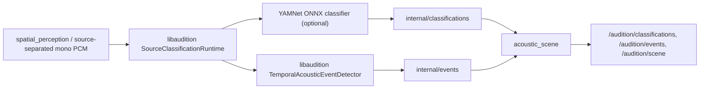

# M2 — semantic classification and acoustic event lifecycle

**Status:** Initial implementation on the code branch. The documentation branch is a separate orphan Sphinx website and does **not** contain ROS packages or model weights.

**Implementation:** [PR #1](https://github.com/ARDev1161/audition_ros2/pull/1) · [C++ semantic adapter](https://github.com/ARDev1161/audition_ros2/blob/feat/m0-ros2-foundation/audition_perception/src/semantic_perception_node.cpp).

## The processing path



The C++ ROS adapter does not duplicate upstream classifiers, bounded inference scheduling or threshold hysteresis. It converts `SourceAudioFrame` observations to the existing `libaudition` runtime, then converts completed classifications and `TemporalAcousticEvent` transitions to ROS message contracts.

The scene node remains the **only publisher** of canonical external classification/event topics. It retains a bounded active-event ledger, updates `AcousticScene.active_events` on event transitions, and rejects inconsistent event IDs or stale stream generations. A completed event is removed from active scene state. Once an event is active, new supporting classification observations produce `UPDATED` transitions; a spatial stream-generation reset produces terminal `CANCELLED` notifications with reason `spatial_stream_reset`. No artificial sound ending timestamp is invented.

## Build-time choices

`AUDITION_ROS2_WITH_SEMANTIC=ON` links the installed `audition::pipeline` backend-neutral runtime. It does not enable an ML model by itself.

`AUDITION_ROS2_WITH_YAMNET=ON` additionally requires the installed `audition::backend_yamnet` CMake target, which is built in libaudition with `LIBAUDITION_WITH_YAMNET=ON`. The YAMNet adapter runs ONNX Runtime CPU. The native CI separately verifies that this optional C++ target can be compiled; it is **not a real model accuracy test**.

The default compilation remains dependency-light: both flags are OFF, so the semantic node's `classifier_backend=disabled` configuration does not infer or publish fictitious classes/events.

## Run (requires externally provisioned model)

```bash
# Clone/build/install libaudition WITH_YAMNET first.
source /opt/ros/humble/setup.bash
export CMAKE_PREFIX_PATH="/path/to/libaudition/install:$CMAKE_PREFIX_PATH"
colcon build --symlink-install \
  --cmake-args -DAUDITION_ROS2_WITH_SEMANTIC=ON -DAUDITION_ROS2_WITH_YAMNET=ON

source install/setup.bash
ros2 launch audition_bringup m2_wav_pipeline.launch.py \
  wav_path:=/path/to/6_channel_recording.wav \
  spatial_backend:=odas \
  spatial_config:=/path/to/measured_array.yaml \
  semantic_config:=/path/to/semantic_yamnet.yaml
```

For a real ODAS path, the microphone geometry must be physically calibrated and native ODAS installed. Without spatial separation, the source audio topic remains empty: the M2 launch currently has no fabricated single-channel shortcut. Do not infer that supplying a mono WAV is sufficient for M2 semantic classification.

Create `semantic_yamnet.yaml` by copying
[the installed example](https://github.com/ARDev1161/audition_ros2/blob/feat/m0-ros2-foundation/audition_bringup/config/semantic_m2.yaml),
then set `classifier_backend: yamnet`, the absolute `yamnet_model`
and `yamnet_labels` paths, and optionally adjust `window_samples`,
`hop_samples` and event thresholds. The Sphinx documentation branch contains
no runtime YAML or model binaries.

The ONNX file must be a *waveform-input YAMNet export*, with float32 mono input at 16 kHz and a score tensor with 521 AudioSet classes. It must match the chosen sample window length. The CSV must contain 521 class labels. Model files are not bundled, downloaded or silently substituted by audition_ros2.

## Implemented initial parameters

The `semantic_perception` node supports:

| Parameter | Default | Meaning |
| --- | --- | --- |
| `classifier_backend` | `disabled` | `disabled` or `yamnet` |
| `yamnet_model` | empty | Absolute compatible ONNX model path |
| `yamnet_labels` | empty | Absolute 521-label class mapping |
| `yamnet_top_k` | 5 | Top classes emitted for each completed window |
| `yamnet_threads` | 1 | ONNX CPU inference thread count |
| `window_samples` | 15600 | One ~0.975 s classification window |
| `hop_samples` | 7800 | 50% overlap |
| `max_sources` | 16 | Bounded per-source state |
| `event_start_threshold` | 0.70 | Native temporal detector onset threshold |
| `event_stop_threshold` | 0.40 | Native temporal detector offset threshold |
| `event_min_start_observations` | 2 | Consecutive above-threshold observations |
| `event_min_stop_observations` | 2 | Consecutive below-threshold observations |

The launch uses `semantic_config` as the **authoritative ROS parameters file**; it does not override its settings with default launch arguments. The shipped YAML disables inference until a real model and labels are supplied. Invalid model/configuration must fail startup rather than silently falling back to `disabled`.

## Source identity and time

Classification runs only on normalized mono 16 kHz source audio. Different `source_generation` values never share a classification window. A discontinuity in per-source `sequence_number`, timestamp or microphone frame forces retirement/reset before new audio is accumulated.

Completed inference messages are timestamped against the audio samples that generated them, not wall-clock model completion. An old result is dropped if its source epoch has retired. ID strings remain different from ephemeral ODAS track IDs and from human `SpeakerId`.

The emitted scores are explicitly **uncalibrated** model outputs; they do not prove physical object existence. There is no metric distance or position inferred from a classification.

## Validation still required

- **Implemented:** deterministic native `libaudition` classification-to-event regression using an injected fake classifier (test only; no fake production events).
- **Implemented:** full native YAMNet/ONNX compile in dedicated CI. Real model-load and model-weight inference checks remain pending.
- Real pinned model inference on a recorded mono source; compare with independent ONNX output, count dropped windows, record per-source inference and queue latency.
- Source retirement and stream reset regressions with in-flight inference; cross-generation event filtering.
- Real ReSpeaker/ODAS separation and microphone calibration, hardware performance on RK3588/Qualcomm.
- Speech model work (Sherpa VAD/Whisper.cpp ASR) is **not yet implemented** in audition_ros2.

Current GitHub CI statuses should be read from [the implementation PR](https://github.com/ARDev1161/audition_ros2/pull/1/checks); a synthetic event-injection smoke tests the canonical ROS publication path, **not** classifier accuracy.
