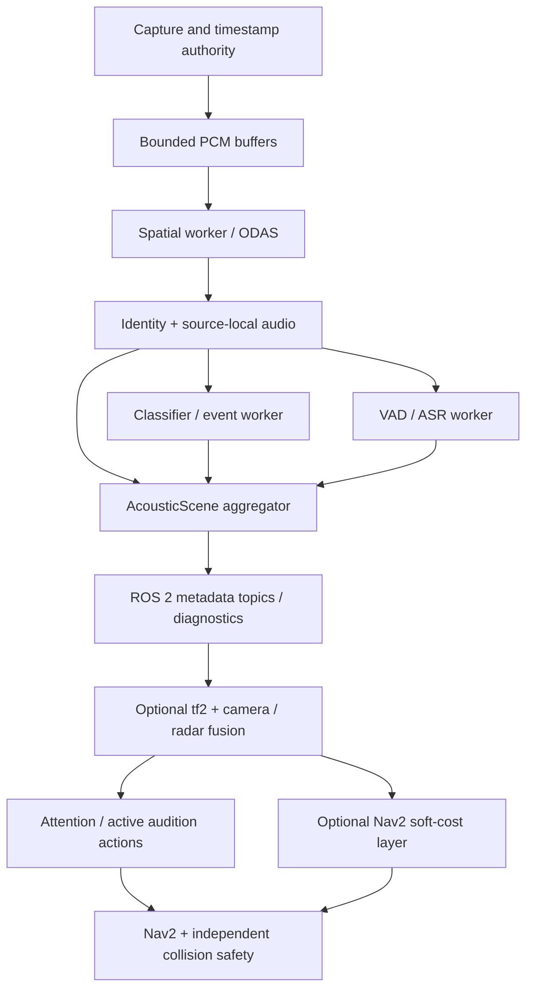
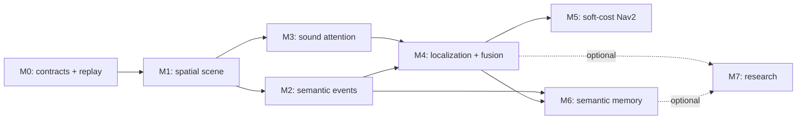

# audition_ros2 — Engineering Roadmap

**Document status:** Proposed architecture and staged implementation plan  
**Updated:** 2026-10-24  
**Baseline:** ROS 2 Humble, Nav2, C++17 `libaudition`, initial ReSpeaker USB 4-Mic Array v2.0; optional OAK-D, 2D LiDAR, IMU, odometry and radar.  
**Scope:** This document describes targets, not existing `audition_ros2` functionality. Backend availability does not establish field accuracy or hardware real-time performance.

See [Human spatial hearing and robot perception](HUMAN_SPATIAL_HEARING.md) for the perceptual rationale and a comparison of biological and engineering approaches.

## 1. Objective and design boundaries

Provide reusable ROS 2 acoustic perception and optional robot-facing consumers. The stack should answer *what was heard, where it was observed, which source hypothesis produced it, when, and with what uncertainty*. It must not automatically equate a detected sound with a physical object, physical position, safety hazard or robot command.

- **libaudition (upstream, unchanged in scope):** backend-neutral DSP; spatial direction, tracks and separation; classifiers and semantic embeddings; VAD/ASR/speaker analysis; source identity; temporal events and acoustic observations. Improvements to generally reusable acoustic algorithms belong upstream.
- **audition_ros2 (this repository):** capture transport adapters, lifecycle, bounded scheduling, clocks, tf2, ROS messages, diagnostics, visualization, audio/perception composition and ROS-facing configuration.
- **Task-specific application packages:** multimodal association, active sensing, Nav2 costmap and behavior plugins, semantic maps, planning and multi-robot coordination. Cross-modal fusion belongs outside the reusable libaudition core.

Design for headless operation, partial backend availability, deterministic replay and independent scaling. Allow a minimal mono/speech configuration without ODAS and a multichannel/spatial configuration with ODAS.

## 2. Capability classification

The terms below have deliberately different meanings:

- **Available upstream:** APIs or algorithms exist in `libaudition`; a ROS node and device-specific validation may not.
- **Near-term engineering:** feasible with the stated sensors; requires implementation/integration and field tests.
- **Research/dependent:** requires additional measurements, training data, specialized geometry or algorithm development.
- **Not justified:** the available observation cannot uniquely support the claimed result.

| Capability | Classification | Minimum evidence/requirements | Principal limitation |
| --- | --- | --- | --- |
| Capture and replay of multichannel PCM | Near-term engineering | ALSA/WAV adapter; known channel order, sample rate and timestamps | USB clock drift, dropout, reconnect |
| DOA, active spatial tracks, separation | Available upstream; ROS integration required | Optional ODAS, calibrated array geometry, annotated real captures | Multipath, inactive sources, spatial aliasing |
| Acoustic source lifetime and identity | Available upstream; ROS integration required | Distinct spatial track / acoustic source / speaker IDs | Identity switches, missing observations |
| Per-source sound classification | Available upstream; ROS integration required | Pinned YAMNet/EfficientAT/sherpa/CLAP weights and per-source audio | Score calibration, domain shift and interference |
| VAD, ASR, KWS, speaker analysis | Available upstream/optional backends | Models, speech audio frontend and bounded inference | Far-field WER, overlap, language, latency |
| Started/Updated/Ended acoustic events | Available upstream in part; ROS lifecycle required | Timestamped per-source scores, hysteresis, retirement, replay | Detection is not object existence |
| Direct robot/camera orientation toward sound | Near-term engineering | DOA + extrinsics/tf2 + motion gating | Does not infer source distance |
| Active localization by robot translation | Research/dependent | Multiple bearings, known sensor poses, persistent stationary source hypothesis | Poor geometry, wrong associations, reflections |
| Audio/vision/radar association | Near-term to research | Synchronized observations, extrinsics, evidence of common cause | False matches, silent or occluded entities |
| Machine-state anomaly detection | Research/dependent | Device-specific baseline + annotations | Anomaly does not imply fault or danger |
| Acoustic semantic memory / room map | Research/dependent | Repeated localized observations and provenance | Observation location ≠ sound origin |
| Acoustic soft-cost Nav2 layer | Dependent on localized hypotheses | Metric position + calibrated uncertainty and expiration | Bearing-only tracks cannot locate cost cells |
| Audio-visual tracking through occlusion | Research/dependent | Common-source association and explicit uncertainty | Identity ambiguity; silence |
| Multi-robot acoustic triangulation | Research/dependent | Common source, clock alignment, sensor poses, network delay handling | Non-simultaneity, association, reflections |
| Passive exact ranging from one DOA | **Not justified** | Additional independent constraints would be required | One bearing contains no metric range |
| Guaranteed occupancy/person absence from silence | **Not justified** | Independent presence sensors required | Quiet objects remain unobservable |
| Guaranteed speaker/person identity or intent | **Not justified** | External verification and action context | Spoofing, ambiguity and non-unique interpretation |

## 3. Proposed workspace packages

| Package | Responsibility | Dependencies |
| --- | --- | --- |
| `audition_msgs` | Versioned messages/actions/services and stable semantic contracts | ROS interface generators |
| `audition_capture` | ALSA, WAV/rosbag adapters; channel mapping, timestamp authority, capture diagnostics | rclcpp, libaudition audio types |
| `audition_perception` | ODAS sessions, source identity, classifiers, VAD/ASR, event assembly, AcousticScene | libaudition, audition_msgs |
| `audition_fusion` | Camera/radar/odometry association, bearing-only localization, hypotheses | tf2, geometry, optional sensors |
| `audition_behaviors` | LookAtSound, TrackSound, InvestigateSound ROS actions and policy interfaces | audition_msgs, Nav2 where enabled |
| `audition_nav2` | Optional costmap/BT/behavior plugins; subscribes to validated hypotheses | Nav2, audition_msgs; no mandatory libaudition link |
| `audition_rviz` | Sources, uncertainty regions and event visualization | visualization_msgs, optional RViz plugin |
| `audition_bringup` | Launch files, composition presets, sensor calibration YAML, model references | other packages |
| `audition_tests` | Deterministic fixtures, rosbag scenarios, performance and hardware acceptance | test dependencies |

**Package boundaries are a plan, not a requirement to implement all packages at M0.** Favor components within a common process for low-bandwidth metadata; keep optional inference and risky third-party backends isolatable in separate processes.

## 4. Data contracts to freeze before feature growth

Minimum proposed interfaces (exact .msg fields require implementation review):

- `AudioFrame` or a documented adapter for `audio_common_msgs`: header with **capture** timestamp, frame count, sample rate, channel mapping, PCM encoding/layout, sequence number and clock provenance. Internal libaudition uses normalized float32; ROS wire encoding is a deliberate transport choice.
- `AcousticSource`: `source_id`, optional `spatial_track_id` / `speaker_id`, sensor-frame **unit bearing**, direction-estimate status/uncertainty, optional range and metric position, observed activity, timestamps, lifecycle and provenance.
- `AcousticEvent`: event ID, source ID, class label/taxonomy/version, score **type** (uncalibrated score vs calibrated probability), Started/Updated/Ended/Cancelled transition, observed time interval and reason for termination.
- `AcousticScene`: timestamped consistent snapshot referencing current source and event IDs, with observation generation and bounded age.
- `LocalizedSource`: metric position **only when estimated**, reference frame, covariance, source-association evidence and source-age/expiration metadata.
- `Transcript`: source ID, speaker ID when available, text, temporal interval, segment/partial/final state, confidence semantics and model provenance.
- `ListenForEvent`, `LocalizeSound`, `InvestigateSound`, `SpeakText`: actions where cancellation/feedback matter. Do not put continuous raw audio in an action goal.

**Hard invariants:**

1. `SpatialTrackId` (backend-local, temporary), `AcousticSourceId` (persistent hypothesis) and `SpeakerId` (voice identity) are never interchangeable.
2. `header.frame_id` names the **actual microphone array frame**; only transformed observations may claim `base_link` or `map` coordinates.
3. A direction vector is not a metric location. Unknown variance/range/position is absent or explicitly marked unknown, **not zero**. ODAS activity is not a calibrated localization confidence.
4. Preserve timestamp and clock domain: libaudition distinguishes UTC, monotonic, simulation and external time; avoid subtracting them without explicit conversion/synchronization. Playback must work with `use_sim_time` and time resets.
5. Never silently promote CLAP similarity, classifier logits or other arbitrary scores to probabilities.
6. Bound the number of tracks, queues, retained segments, timestamps, model jobs, output messages and memory.
7. Unknown/expired hypotheses produce **no** costmap obstacle. Expiration must clear old soft costs, including when no new event is published.
8. No default audio-derived `cmd_vel` or `LETHAL_OBSTACLE` path. Robot behavior must run behind authorization, independent collision prevention and Nav2 limits.

## 5. Runtime topology

- Capture must not block on models, DDS subscribers or map updates; use bounded lock-aware or lock-free queues with explicit overload behavior.
- Separate spatial processing from slower model inference. Carry frame sequence and source-generation IDs to reject late results after source retirement/reassignment.
- Stateful ODAS operations must remain instance-confined. Reconstruct/reset outside the capture real-time path.
- Run ODAS in a separate process if its upstream fatal paths or restart behavior cannot be contained in a shared component container.
- Delay/noise suppression and AEC are **not** transparent preprocessing for raw spatial channels: preserve geometry and phase; feed the speech branch separately and provide true pre-DAC playback reference for AEC.
- Prefer `rclcpp_components` and explicit lifecycle for startup/stop; define a clean non-component process mode. Transport raw PCM only when an actual consumer needs it.
- QoS should follow semantics: small best-effort queues for streaming sensor audio as appropriate; reliable bounded event delivery where required; do not use transient-local as a substitute for a proper scene snapshot API.
- Expose timing (capture-to-observation, observation-to-event), drop counters, queue occupancy, source handoffs, reset causes, and backend versions.

## 6. Work phases, deliverables and acceptance gates

No calendar estimates are asserted. Gate criteria should be set on recorded datasets and hardware before being treated as release promises.

### M0 — Interface and evaluation baseline (P0)

Deliver:
- ROS package skeleton and CI for Humble / Ubuntu 22.04, fixed upstream `libaudition` revision, separate default and optional-backend build profiles.
- Message/action design review, explicit clock/coordinate/uncertainty contract, dependency and license manifests.
- ReSpeaker profile (six captured USB channels; zero-based ODAS microphone route `{1,2,3,4}` subject to confirming hardware mapping, gain and 3-D orientation).
- Synthetic and recorded multi-source fixture schema with ground-truth direction, source activity, speech windows, source/event identities and captured platform motion.

Gate:
- Clean `colcon build`, `ament_lint`, interface round-trip tests, ROS↔libaudition data adaptation tests, deterministic rosbag/WAV replay.
- Negative tests for malformed format, unknown clock, invalid frames, missing TF, model absence, incompatible sample rate.

### M1 — Spatial acoustic perception (P0)

Deliver: `audition_capture` and `audition_perception`; `/audition/sources`, `/audition/scene`, diagnostics; optional ODAS; minimal RViz markers; lifecycle and watchdog/reset behavior.

Gate:
- Hardware smoke with valid multi-channel capture and calibrated microphone geometry.
- Annotated static/moving source trials at several angles; assess angular error, missed sources, false tracks, ID switches, time-to-first-detection and dropouts.
- Explicitly test short/quiet speech, 1/2/5 overlapping sources, unplug/replug, silence, source loss, no-stale-marker behavior, capture restart without hidden stop.
- Metrics recorded, thresholds chosen against a measured baseline; skipped real-array tests remain SKIP, never PASS.

### M2 — Semantic perception and events (P0/P1)

Deliver: source-local classification, hysteresis/temporal events, VAD/ASR, optional KWS/speaker modules; event and transcript topics; per-source buffered inference; safe model configuration.

Gate:
- Started/Ended/Cancelled emitted deterministically across reordering, drops, identity handoff, VAD restart, clock resets and model failure.
- Measured per-class precision/recall (or F1), onset/end delay, source-to-class assignment; WER/CER for declared languages and speaker overlap cases.
- No inference backlog growth, bounded retained audio; no conflation of model scores and posterior probabilities.

### M3 — Attention and active audition (P1)

Deliver: `LookAtSound` / `TrackSound` actions, optional camera pointing or safe base rotation, tf2 timestamped bearing transforms, source selection and cancellation; visualization of bearing rays.

Gate:
- Robot turns in the correct direction against surveyed reference angles; a silent/expired source never triggers a delayed movement.
- Rotation respects Nav2 motion admission, footprint, obstacle checks and external stop.
- Compare localization quality before/after controlled rotation; record cost of motor/ego-noise.

### M4 — Audio-visual / range fusion and localization (P1/P2)

Deliver: `audition_fusion` with independent evidence tracks, AV association with time/angle/visual activity gates, bearing triangulation after *translation*, covariance propagation and ambiguity preservation; optional radar observation adapter.

Gate:
- Ground-truth evaluation of association precision/recall, range error, false triangulation, poor-baseline conditioning, calibration error, time skew, reflections and moving speakers.
- Show a **positive gain over independent sensing**, not just plausible videos.
- Reject 3-D localization when geometry or data are insufficient; treat multiple plausible sources separately.

### M5 — Navigation integration (P2; gated by M4)

Deliver:
1. Sound attention BT/action helpers, preferred initial navigation integration.
2. Optional `AcousticCostmapLayer` with `nav2_costmap_2d` callbacks (e.g. `updateBounds`/`updateCosts`), scoped cost changes and explicit clearing on expiration.
3. Acoustic semantic observations separate from physical occupancy.

Gate:
- Metric source position and uncertainty are mandatory for spatial cell updates. Bearing-only and unlocalized sound must leave the costmap unchanged.
- Use **soft costs only** by default, and no audio-only lethal obstacles. Existing LiDAR Collision Monitor or equivalent safety layer remains independent.
- Tests: stale source, no new messages, stale TF, out-of-order update, map resize, rolling-window shift, footprint traversal, map clearing, multiple competing sources and bounded CPU.
- Baseline compare route safety/utility against Nav2 without acoustic costs; rollback if no measurable gain.

### M6 — Acoustic memory and application reasoning (P2/P3)

Deliver: persistent provenance-aware event map and room-level summaries, anomaly/change analysis, source revisit, optional PlanSys2 predicate bridge and limited OpenRMF fleet events.

Gate:
- Store robot pose at *observation time* separately from inferred source location.
- Explicit retention/consent policy for speech, bounded history and no unverified sound→entity→PDDL promotion.
- Test false association, map relocation, long-term drift, room adjacency and source persistence.

### M7 — Research extensions (P3; optional independent tracks)

Candidate tracks:
- `EgoNoiseEstimator` from motor commands, wheel speed, IMU and audio, validated for near-field external sounds.
- Active vantage-point planning using expected information gain and measured localization uncertainty.
- Multipath/direct-path confidence estimator; acoustic room signatures / self-localization hypothesis.
- Multi-robot bearing/temporal fusion with clock synchronization and hypothesis deduplication.
- Geometry study: current compact planar array vs three-dimensional array / rigid baffle; per-platform transfer-function calibration.
- Acoustic SLAM, specialized self-supervised embeddings or learned world models only after simpler sensor-fusion baselines fail measurably.

Each research track requires an independent hypothesis, dataset, objective metric and explicit no-go criterion. None is a prerequisite for a first ROS release.

## 7. Critical dependency graph

**First usable milestone:** M0–M3 with reproducible capture, stable source lifecycle, semantic events, and attention behaviors. Costmap is not the entry point; it is an *optional later consumer* of validated metric source hypotheses.

## 8. Benchmark and test matrix

| Test family | Scope | Evidence to record |
| --- | --- | --- |
| Contract/unit | timestamp conversion, frames, identity, lifecycle, transformations, probability semantics | Assertions, serialization and ABI/API compatibility |
| Synthetic perception | known directions, overlap, silence, noise, room simulations | DOA error, false alarm, coverage, ID switches |
| Real annotated captures | ReSpeaker in several rooms with measured positions/angles | DOA/SSS accuracy, event F1, WER, tracking |
| HIL/mobile | moving platform, motors, AEC/playback, USB reconnect | end-to-end latency p50/p95/p99, drop rate, uptime |
| Safety/failure injection | missing TF, stale scores, clock jump, wrong sensor geometry, faulting backend | no unexpected actions/costs, deterministic recovery |
| Nav2 integration | static/rolling maps, resize and clear, active objectives | planned-path differences, collision monitor unaffected |
| Resource | embedded RK3588 and desktop configurations separately | CPU, RSS, bounded allocations/queues, thermal/power |

Use pinned model identifiers, dataset hashes, recording geometry, hardware revision and exact git SHA in results. A passing simulated pipeline is not a device accuracy claim.

## 9. Hard limits and non-goals

- **No single-bearing metric range.** ODAS direction does not imply range or 3-D location; only separate estimation/fusion may populate those fields.
- **No guaranteed localization behind a wall or around a corner.** Reflections/diffraction make direct-path assumptions unreliable; preserve multiple hypotheses or abstain.
- **No proof of absence from silence.** A quiet person, vehicle or obstacle is acoustically unobservable.
- **No guaranteed source separation/recognition from arbitrary mixtures.** Overlap, reverberation and insufficient aperture can make source assignment unidentifiable.
- **No calibrated danger or intent inference from a sound label.** A bark does not prove a dog is at an obstacle cell; a scream does not prove a particular location or cause.
- **No perfect voice identity or anti-spoof guarantee.** Require independent authorization for safety-sensitive speech actions.
- **No implicit safe mapping of audio results to movement.** Maintain explicit policy and independent physical safety sensors.

## 10. External implementation references

- [libaudition functional architecture](https://github.com/ARDev1161/libaudition/blob/main/docs/functional_architecture.md), [API specification](https://github.com/ARDev1161/libaudition/blob/main/docs/specification.md), [ODAS contract](https://github.com/ARDev1161/libaudition/blob/main/docs/backends/odas.md) and [RC acceptance limitations](https://github.com/ARDev1161/libaudition/blob/main/docs/release_v1_rc1.md).
- [Nav2 costmap plugin tutorial](https://docs.nav2.org/jazzy/tutorials/plugin_tutorials/writing_new_costmap2d_plugin/writing_new_costmap2d_plugin/) (check the ROS distro-specific API when implementing).
- [ROS audio_common messages](https://github.com/ros-drivers/audio_common/tree/ros2/audio_common_msgs/msg).
- [LOCATA challenge paper](https://doi.org/10.1109/TASLP.2020.2990485) — realistic localization/tracking evaluation in moving and reverberant scenes.
- [Active Audition for Humanoid](https://mlanthology.org/aaai/2000/nakadai2000aaai-active/) — source tracking through audition, vision and self-motion.

## 11. Decision log (initial)

| Decision | Rationale |
| --- | --- |
| Keep libaudition free of ROS 2 | General reuse and backend-independent algorithms |
| Publish scene, events and hypotheses rather than raw classifier actions | Enables alternative consumers and audits |
| Prefer separated perception/association/action | Avoid turning ambiguous sound into an unsafe behavior |
| Metric fusion before costmap | DOA alone lacks range |
| Adopt hybrid DSP + probabilistic fusion + learning | Existing physically interpretable and deterministic algorithms remain valuable |
| Test real ReSpeaker observations before accuracy claims | Synthetic/backend CI does not validate robot-mounted spatial perception |

This document should evolve through measured results and ADRs. Completing a code path is not the same as passing its hardware acceptance gate.
