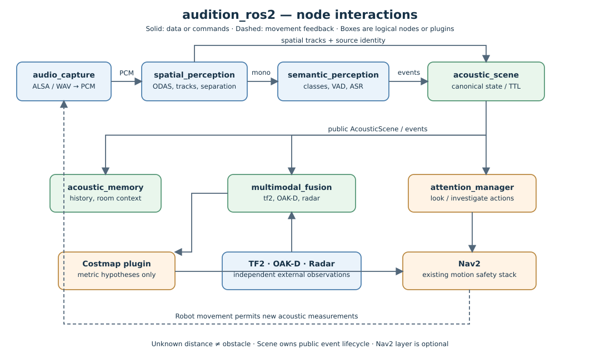
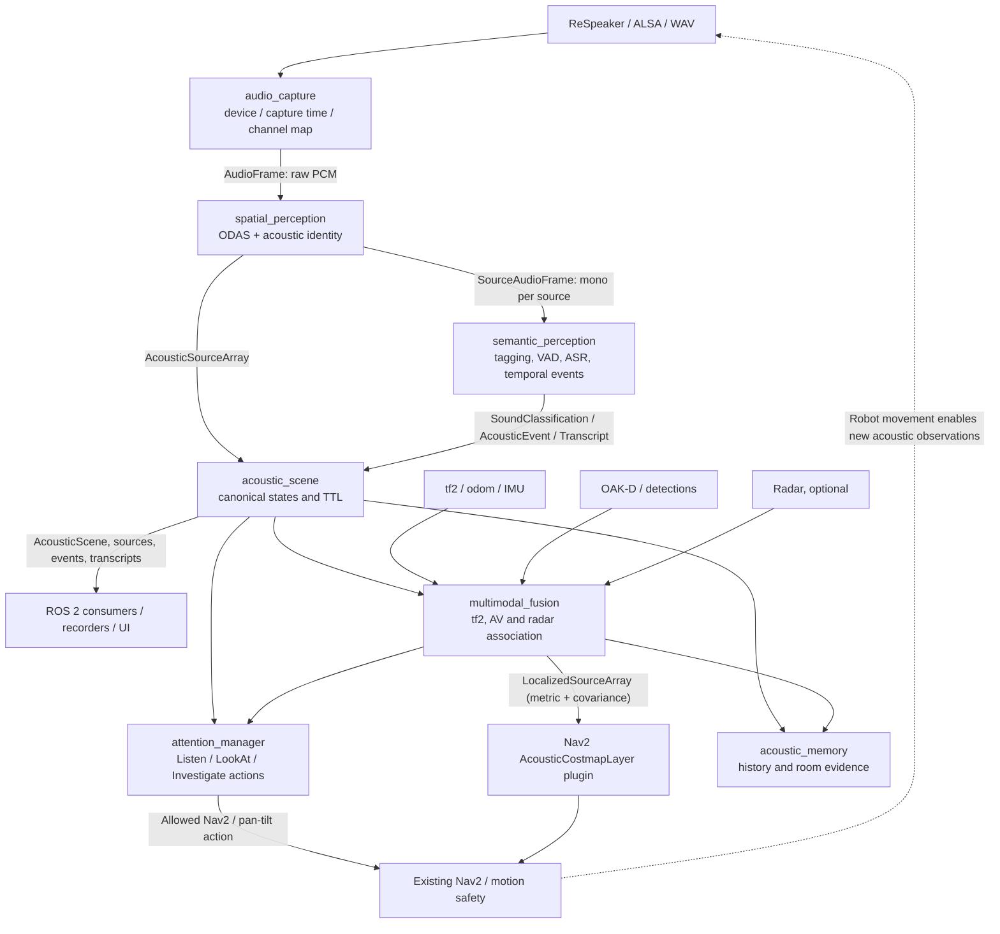

# ROS 2 Node Architecture and Execution Contracts

**Status:** Proposed baseline, 2026-10-24  
**Scope:** ROS 2 Humble, Nav2, libaudition; incremental implementation defined by [ROADMAP.md](ROADMAP.md).  
**Related:** [Human spatial hearing / engineering alternatives](HUMAN_SPATIAL_HEARING.md).

## 1. Architectural decision

Use **a small number of capability-oriented ROS nodes**, not one node per libaudition algorithm. A node boundary exists where lifecycle, hardware resources, latency class, security/failure isolation, transport ownership or independent scaling warrant it. DSP algorithms, CUSUM/EMA/DTW, identity registries, VAD internals, ODAS stages and classifiers are *components within nodes*.

Core perception uses **four logical nodes**:

1. `audio_capture`: hardware and recording ingest, format/clock authority, bounded PCM production.
2. `spatial_perception`: microphone geometry, phase-safe calibration, ODAS, track management and persistent acoustic source IDs; separated mono frames.
3. `semantic_perception`: per-source event classification, VAD, ASR, speaker/voice models and timestamped semantic observations; optional independent workers internally.
4. `acoustic_scene`: authoritative time-aligned scene snapshots, observation provenance, source-event lifetime, validation/retirement, canonical ROS-facing publications.

Optional consumer nodes: `attention_manager` (active audition actions), `multimodal_fusion` (AV/radar/pose association and *metric* estimation), `acoustic_memory` (time-indexed event storage), and optional `speech_output` (speaker playback / TTS). Nav2 costmap and behavior tree integrations are **plugins of existing Nav2 processes**, not standalone acoustic nodes. Diagnostics are published *by each node*, not by a new diagnostics relay.

### Node count (this stack only)

| Roadmap gate | Increment | Running nodes | What is available |
| --- | --- | ---: | --- |
| M0 contracts | ROS interface package and offline contract tests | **0** | Schemas/config; no physical audio runtime |
| M1 spatial | capture + spatial + scene | **3** | Raw PCM, source bearings/identity, scene |
| M2 semantic | semantic | **4** | Classes, acoustic events, transcripts |
| M3 active attention | attention | **5** | Safe source orientation and investigative actions |
| M4 sensor fusion | fusion | **6** | Source/object association, validated metric locations |
| M5 Nav2 | loaded costmap/BT plugins | **6** | Optional *soft* acoustic costs and Nav2 behaviors |
| M6 memory | memory | **7** | Time-aware acoustic semantic evidence |
| M7 research | conditional separate evaluation components | **7+** | Ego-noise, SLAM, multi-robot etc., not compulsory |

Counts exclude `/rviz2`, `/camera`, existing Nav2 servers, TF publishers, audio-driver internals and external lifecycle managers. If `speech_output` is enabled, add **one** node. A dedicated visualization relay is optional (add one), but RViz custom displays/markers do not mandate it. A lifecycle supervisor may be a further separate existing ROS node; account for it in deployment totals.

## 2. End-to-end data flow

[Mermaid source](diagrams/acoustic_interaction_flow.mmd). Keep the source and rendered illustration synchronized with the interface topology.

There is **no** semantic/attention feedback into the raw-capture callback. Feedback for selective heavier models uses commands/configuration or explicit per-source subscriptions and never creates a synchronous dependency from capture to an inference worker.

**Canonical public interface owner:** `acoustic_scene` publishes `/audition/scene`, `/audition/sources`, `/audition/events` and `/audition/transcripts`. Spatial and semantic nodes publish intermediate observations under `/audition/internal/*`. Applications should never need to subscribe to internals.

## 3. Responsibilities and anti-responsibilities

| Node | Owns | Must not do | Scheduling / failure policy |
| --- | --- | --- | --- |
| `audio_capture` | ALSA device handle or WAV/rosbag source, sample format, channel count/order, device reconnect, capture timestamp mapping, stream sequence and diagnostics | ODAS processing, inference, TF lookup, navigation | Dedicated capture worker, bounded publisher queue; never waits for a subscriber |
| `spatial_perception` | Calibrated array geometry, ODAS instance, exact hop/chunk adaptation, active spatial tracks, libaudition source-identity coordinator, source-separated frames | Decide whether class labels represent physical objects; fabricate range | Single serialization of ODAS `process/reset`, bounded workers; isolation via separate process recommended for ODAS fatal paths |
| `semantic_perception` | Independent source-keyed inference queues, sound tagging/CLAP/YAMNet, VAD, ASR, speaker and temporal event detectors, bounded model resources | Modify spatial source IDs, publish navigation obstacles, keep an unbounded audio archive | Worker pools, per-source generation checks; late results rejected |
| `acoustic_scene` | Last accepted observations, event validation/association, canonical started/updated/ended/cancelled lifecycle, snapshot generation, source TTL, scene publications | Perform heavy inference or motion; fill unknown covariance with zero | Fast callbacks, bounded state, monotonic freshness and explicit reset across clock/capture changes |
| `attention_manager` | Pick sound target, priority/TTL, action goals, safe look/turn/investigation and cancellation | Bypass Nav2 safety; use bearing as navigation goal | ROS actions and asynchronous Nav2 clients |
| `multimodal_fusion` | Calibrated time/pose cross-modal association, distinct visual/radar/world IDs, source triangulation, uncertainty and multiple hypotheses | Rewrite acoustic observations; claim direct-path or metric position without evidence | Independent workers; refuse localization on TF/geometry failure |
| `acoustic_memory` | Timestamped observations, source/room provenance, retention/decay, revisable links | Decide physical safety or long-lived source existence based on unverified sounds | Async persistence with bounded storage and consent policy |

A speaker/TTS path (optional `speech_output`) should publish a pre-DAC reference for the separate AEC speech branch. Speech enhancement/AEC must **not** be inserted blindly before ODAS spatial processing, because it may alter inter-channel phase.

## 4. Topic contracts and ownership

Names below are recommended relative to the `/audition` namespace. Use declared ROS parameters to remap sensor-specific instances, rather than hard-coded absolute names in code.

| Publisher | Topic | Message | Subscriber(s) | Suggested QoS |
| --- | --- | --- | --- | --- |
| capture | `audio/raw` | `AudioFrame` | spatial (and optional debug recorder) | sensor best-effort, volatile, depth 2–4 |
| spatial | `internal/spatial_sources` | `AcousticSourceArray` | scene | sensor-like latest-state, volatile depth 4 |
| spatial | `internal/source_audio` | `SourceAudioFrame` | semantic | sensor best-effort, volatile depth 2–4 |
| semantic | `internal/classifications` | `SoundClassification` | scene | volatile best-effort or bounded reliable according to loss contract |
| semantic | `internal/events` | `AcousticEvent` | scene | reliable, volatile, bounded depth |
| semantic | `internal/transcripts` | `Transcript` | scene | reliable, volatile, bounded depth |
| scene | `scene` | `AcousticScene` | HRI, attention, fusion, RViz, planners | reliable snapshots, volatile, modest depth |
| scene | `sources` | `AcousticSourceArray` | UI, debugging, consumers | volatile, bounded |
| scene | `events` | `AcousticEvent` | behaviors, logger, memory | reliable volatile; duplicate-safe event IDs |
| scene | `transcripts` | `Transcript` | HRI, ASR consumers | reliable volatile; privacy/access policy |
| fusion | `localized_sources` | `LocalizedSourceArray` | attention, memory, Nav2 costmap | reliable volatile, bounded |
| every runtime node | `/diagnostics` | `diagnostic_msgs/DiagnosticArray` | diagnostic aggregator | standard diagnostics QoS |

**Publisher authority:** Clients use scene topics; `semantic_perception` does not also publish canonical `/audition/events`. This prevents duplicates, inconsistent retirement and cross-topic cycles.

**Snapshot/stream trade-off:** `scene` is a bounded coherent snapshot, not a complete event log; `events` carries transitions. Consider a `GetScene` service for new subscribers if late-joiner semantics require an immediate snapshot, instead of relying on transient-local durability for the entire system.

**ROS time:** `std_msgs/Header.stamp` is meaningful only after device hardware or monotonic time has been converted to the configured ROS time basis. Preserve capture-clock metadata/provenance separately. Use time from the first PCM sample; do not restamp frames when models finish. The current libaudition `Timestamp/ClockIdentity` is not directly interchangeable with ROS time.

**Geometry:** `direction_unit` is expressed in the microphone array frame; it may be transformed by tf2 at its observation timestamp. Unknown metric range/position remains absent, not zero. A source missing confidence variance must not be assigned a fabricated covariance. `LocalizedSource` is created only by a measured localization estimator, with method and uncertainty.

**Frame/source generations:** Use a monotonically increasing local `generation` and unique per-device/boot source identifiers to guard against ODAS track ID recycling, delayed inference after reset, and source collision across multiple microphone arrays or robots.

## 5. Internal architecture per node (not more ROS nodes)

`audio_capture`:
- source adapters: ALSA live input, deterministic WAV/rosbag for testing;
- capture-state controller and reconnect;
- sample layout/format checks, measured signal quality and per-channel calibration profile;
- capture worker → bounded publisher; optional no-PCM publish when local consumers share process.

`spatial_perception`:
- chunk adapter to exact ODAS hop size; preserve original capture stamp and frame sequence;
- microphone-array calibration and geometry, phase-safe channel routing;
- ODAS engine, spatial tracks and SSS slot-to-track mapping;
- stable source-ID coordination and terminal transitions on reset/loss;
- outputs: latest-source snapshot and separated source audio tagged with source generation.

`semantic_perception`:
- per-source VAD/ASR ingress, optional heavy sound tagger and KWS;
- per-source event hysteresis, model version and score-type semantics;
- source-local worker queues with cancellation; rate shaping and acoustic attention hints;
- feedback for control may configure **which** sources get heavy inference; the baseline low-cost classification must remain independent of behavior node availability.

`acoustic_scene`:
- authoritative source/status lifetime, semantic reconciliation, duplicate suppression;
- coherent scene stamp/generation and observation provenance;
- source retirement also invalidates old classification/transcription mappings;
- event `CANCELLED` on restart/reset where an explicit natural `ENDED` cannot be justified;
- reports stale sources without asserting that the physical source has disappeared.

## 6. Deployment profiles and process isolation

The **logical node count is independent from OS process count**. Select the process topology by measured latency and failure policy.

| Profile | Process layout | Why |
| --- | --- | --- |
| Minimal M1 | capture + scene in one component container; spatial in separately restartable process | Keep capture alive if ODAS errors, while avoiding another scene process |
| Default M2–M3 | capture + scene in component container; spatial isolated; semantic isolated; attention process or component | Four or five nodes across roughly 3–4 processes; clean fault containment |
| Low-overhead experimental | capture + spatial + scene composed with intra-process enabled; semantic optional separate | Benchmark local copy/latency costs; **not** safety baseline if ODAS fatal exit can kill the capture process |
| Distributed | capture/spatial on robot; inference on a compute PC only when link and data sensitivity permit; scene near robot safety consumers | Network disruptions must not produce phantom active sound sources or stale robot actions |

The real ODAS adapter in `libaudition` has upstream fatal paths that may invoke `exit()`. Process isolation is safer than placing every backend in one process. Passing audio through DDS between isolated processes has copy/serialization overhead; benchmark actual hardware. **Do not promise zero-copy for variable-length `float32[]` ROS messages.**

A six-channel float32 16 kHz raw stream is approximately **384,000 bytes/s** of PCM before transport overhead; this is modest on local hardware, but outputting many separated sources, repeated raw recordings or networking to an external PC can increase total traffic. Use bounded output and disable raw-audio publishing to remote subscribers by default.

## 7. Lifecycle, parameters, and recovery

For capture, spatial, semantic and scene, use `rclcpp_lifecycle::LifecycleNode` (or a documented equivalent when component compatibility is restrictive). Bringup order:

```mermaid
flowchart LR
  C["Configure capture"] --> S["Configure spatial"]
  S --> SEM["Configure semantic (optional)"]
  SEM --> SC["Configure scene"]
  SC --> A["Activate subscribers first"]
  A --> B["Activate capture last"]
  B --> RUN["Active perception"]
  RUN --> STOP["Deactivate capture first"]
  STOP --> DRAIN["Drain/cancel inference; expire tracks"]
  DRAIN --> CLEAN["Cleanup/reconfigure"]
```

For M1 without semantic, skip its stage. Prefer separate explicit subscription readiness and source-generation fences to assuming lifecycle activation ordering eliminates races. Lifecycle supervisors do not automatically own device reconnect or state recovery.

- On device disconnect: stop emitting PCM; emit diagnostics, increment generation, expire affected spatial tracks/events and rebuild backend only outside capture callbacks.
- On model crash or overload: keep capture/spatial active and publish degraded semantic health; do not block scene updates.
- On ODAS crash: isolated supervisor restarts only spatial; scene expires those sources and rejects late semantic results.
- On ROS simulation clock jump: reset time-dependent windows and cross-frame association; do not subtract timestamps from different clock domains.
- On TF unavailable: retain bearing in sensor frame, do not invent `map` position.
- On slow consumer: drop old PCM deterministically and count drops; never silently accumulate seconds of stale audio.
- On stale `LocalizedSource`: remove cost contribution and invalidate attention targets; preserve a historical record only in memory.

Parameter ownership: capture owns hardware format/device; spatial owns array geometry and ODAS options; semantic owns model selection, buffers and thresholds; scene owns TTL/publication rate; attention owns task priorities/motion limits; fusion owns association/calibration; Nav2 plugin owns soft-cost function and expiration. Distinguish configurable parameters from unsupported runtime-hot changes: geometry and model changes may require deactivation/reconfigure.

## 8. Navigation: why not a costmap node?

`AcousticCostmapLayer` is a library plugin loaded by an existing Nav2 layered costmap. It reads **validated** metric `LocalizedSourceArray`, not raw DOA, classifications, scene text or acoustic source audio.

The plugin must:
- update bounds and costs for changed/new/expired hypotheses;
- correctly clear its *own contribution* after TTL and map resize/rolling shifts, with merge behavior compatible with the selected costmap update method;
- use **soft costs** by default; require explicit downstream safety policy for any stronger behavior;
- preserve independent LiDAR/Collision Monitor and robot motion limits;
- degrade to neutral cost when an observation is out of frame, has invalid covariance, lacks transform, has bad freshness or cannot be localized.

The `attention_manager` should be the first Nav2 integration (look and investigate), not a costmap. Nav2 BT plugins and action clients belong to existing Nav2 infrastructure; there is no additional acoustic ROS node solely for these plugins.

## 9. Testing decisions from the roadmap

| Phase | Required interface / behavior tests |
| --- | --- |
| M0 | rosidl build; message serialization/round-trip; timestamp/clock conversion; invalid array lengths; ID validity; zero/NaN/unit-vector negative tests; sensor profile load validation |
| M1 | real ReSpeaker geometry and DOA dataset; track continuity, retirement, reset; capture reconnect, ODAS process crash and replay |
| M2 | per-source classification and speech timing, event transition invariants, late inference, overload/cancel, source ID re-use |
| M3 | source orientation / cancel / missing TF / stale-event / safety-stop scenarios |
| M4 | association with distractors, moving source, multipath, triangulation degeneracy and covariance realism |
| M5 | costmap stale clearing under no new messages, map resizing/rolling, neutral-on-unknown, safety isolation |
| M6 | observation vs source location, history decay, data retention and cross-session source ambiguity |

**First implementation boundary:** keep the M0 code focused on `audition_msgs` and reproducible validation. Do not add dummy microphone, ODAS, lifecycle or navigation executables just to match a planned architecture.

## 10. Decision checklist before M1

- [ ] Validate Humble interface generation / C++ consumption in CI.
- [ ] Decide whether `SourceAudioFrame` carries stream generation in addition to source ID and sequence.
- [ ] Confirm sensor geometry/profile measurements (six captured channels, ODAS zero-based indices 1–4 for the documented ReSpeaker v2 configuration).
- [ ] Lock event state/score representations and per-source lifespan rules.
- [ ] Establish a rosbag fixture set and independent measured reference bearings.
- [ ] Verify source-ID uniqueness after capture/ODAS restart.
- [ ] Select the default process topology based on fault isolation, not presumed zero-copy.
- [ ] Measure a CPU/latency baseline on the target RK3588.

## References

- [ROS 2 managed-node lifecycle design](https://design.ros2.org/articles/node_lifecycle.html)
- [ROS 2 Humble topics/services/actions guidance](https://docs.ros.org/en/humble/How-To-Guides/Topics-Services-Actions.html)
- [ROS 2 intra-process communication overview](https://docs.ros.org/en/humble/Tutorials/Demos/Intra-Process-Communication.html)
- [Nav2 costmap plugin development](https://docs.nav2.org/plugin_tutorials/docs/writing_new_costmap2d_plugin.html)
- [libaudition functional architecture](https://github.com/ARDev1161/libaudition/blob/main/docs/functional_architecture.md)
- [libaudition ODAS engine contract](https://github.com/ARDev1161/libaudition/blob/main/docs/backends/odas.md)
