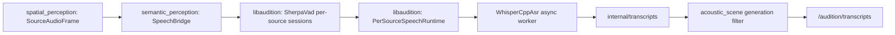

# Per-source speech: Sherpa VAD and whisper.cpp ASR

**Status:** Experimental M2 adapter, available in the separate ROS implementation branch. This documentation branch contains no native model weights, ROS packages or build artifacts.

## Design



There is **no standalone ASR ROS node**. The speech bridge is part of the semantic-perception node, which runs in a separate component container from ODAS and capture. It does not move VAD segmentation, ASR scheduling, initial-context recovery or repeated-text filtering out of `libaudition`. Do not confuse source ID with speaker identity.

- VAD runs synchronously in the semantic process; ASR runs in the bounded worker of `PerSourceSpeechRuntime`.
- Source-separated mono PCM at **16 kHz** is required. No implicit resampling, mixing, fake direction or mono fallback is provided.
- One independent Sherpa VAD session is created for each source. The native Silero VAD supplies speech segment boundaries. The first native utterance can preserve up to **1 second of actual source audio** preceding the model's delayed detected start.
- `PerSourceSpeechRuntime` supports configurable ASR-only normalization. The original VAD/capture audio is not replaced with an enhanced signal.
- Each result carries the original ROS source ID/generation and audio capture timestamps. `speaker_id` is unset unless a separate, validated speaker recognizer is installed.
- The canonical `/audition/transcripts` publisher is **acoustic_scene**, which drops wrong stream generations and invalid final transcripts. No model results are fabricated when speech is disabled.

## Building native backends

The application requires `libaudition` built and installed with `LIBAUDITION_WITH_SHERPA=ON` and `LIBAUDITION_WITH_WHISPERCPP=ON`. whisper.cpp must be installed separately with `libwhisper` and `whisper.h`. Follow the pinned native speech build workflow in the code branch for dependencies and versions.

```bash
# After installing a compatible libaudition, Sherpa and whisper.cpp:
source /opt/ros/humble/setup.bash
export CMAKE_PREFIX_PATH="/path/to/libaudition/install:$CMAKE_PREFIX_PATH"
colcon build --symlink-install \
  --cmake-args -DAUDITION_ROS2_WITH_SEMANTIC=ON \
               -DAUDITION_ROS2_WITH_SPEECH=ON

source install/setup.bash
ros2 launch audition_bringup m2_wav_pipeline.launch.py \
  wav_path:=/path/to/six-channel.wav \
  spatial_backend:=odas \
  spatial_config:=/path/to/calibrated_mics.yaml \
  semantic_config:=/path/to/semantic_speech.yaml
```

For a live ALSA microphone instead of WAV, build `audition_capture` with
`-DAUDITION_ROS2_WITH_ALSA=ON` and use:

```bash
ros2 launch audition_bringup m2_alsa_pipeline.launch.py \
  device:=hw:2,0 sample_rate_hz:=16000 channel_count:=6 \
  spatial_backend:=odas \
  spatial_config:=/path/to/calibrated_mics.yaml \
  semantic_config:=/path/to/semantic_speech.yaml
```

The ALSA card name `hw:2,0` is illustrative. Inspect `arecord -l` for
the device actually connected to the robot. The demo has no automated
microphone calibration or automatic conversion from a mono capture stream.

This launch also requires the optional **ODAS** backend to emit per-source PCM. The ReSpeaker microphone geometry must be physically calibrated before real localization. The example paths above are placeholders.

## User profile

Copy the existing `audition_bringup/config/semantic_m2.yaml` from the code branch, then enable speech:

```yaml
"/**/semantic_perception":
  ros__parameters:
    classifier_backend: disabled
    speech_enabled: true
    speech_vad_backend: sherpa
    speech_asr_backend: whispercpp
    speech_vad_model: "/opt/robot/models/silero_vad.onnx"
    speech_asr_model: "/opt/robot/models/ggml-base.bin"
    speech_language: "ru"
    speech_asr_threads: 4
    speech_vad_threshold: 0.5
    speech_max_sources: 8
    speech_max_pending_segments: 16
    speech_native_initial_context_ms: 1000
    speech_normalize_asr_segments: false
```

**No models are downloaded automatically.** Paths are illustrative; supply compatible Sherpa Silero VAD and whisper.cpp model files from reputable upstream sources, verify their licenses and hashes, and measure actual performance. `speech_enabled=false` is the default fail-closed mode. RU ASR uses whisper.cpp; do not configure SenseVoice's unsupported Russian language code.

## Failure, source and timing semantics

A source generation is a timeline epoch, not a stable human identity. Reused IDs, backward timestamps, and large capture discontinuities cancel the current source's pending speech. A clean `ENDED` source instead calls native `retire()` to flush its final unfinished phrase without waiting for ASR. `drainReady()` returns completed transcripts plus the retired generations that are safe to release; metadata remains associated with the original generation until release.

When a spatial stream generation changes, all old pending speech is invalidated. A transcript's `observed_start` and `observed_end` are audio times, not the time inference completed. The bridge emits only final transcripts; partial results are a later feature.

## Validation and remaining work

The native model-independent test uses a deterministic VAD and fake ASR to verify independent per-source generations, retirement and output text. A ROS graph smoke verifies the public transcript publisher and rejection of wrong stream generations. The native speech CI separately compiles actual Sherpa and whisper.cpp backends but **does not download model weights or make an accuracy claim**.

Still required: real 16-kHz source-separated ReSpeaker recordings, Russian word-error evaluation, overlap/echo tests, benchmarked ASR CPU usage, initial-utterance regression on real Silero, failure/reconnection recovery and model provenance. A fully bounded pre-VAD callback queue and diagnostics remain follow-ups.
