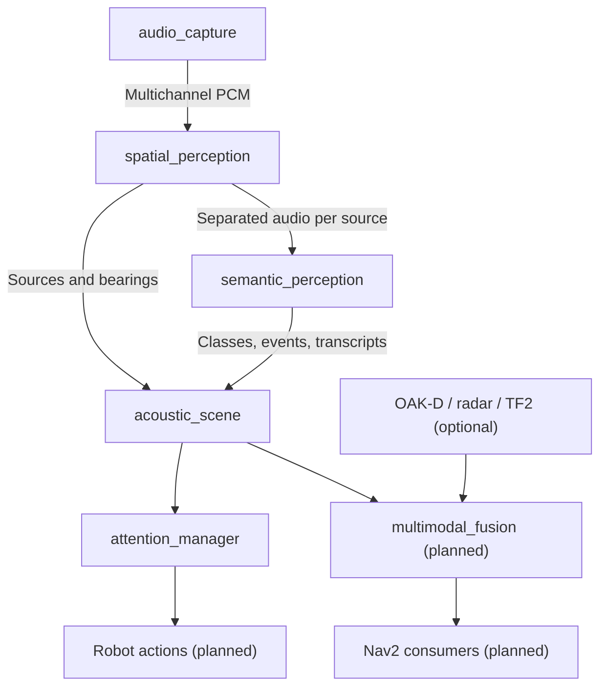

# audition_ros2

**ROS 2 integration for [libaudition](https://ardev1161.github.io/libaudition/)** — acoustic perception, spatial observations, speech events and robot-facing interfaces.

Audio algorithms remain in `libaudition`. This repository owns ROS 2 transport, lifecycle, configuration, TF2 and optional robot behavior. A sound bearing is **not** a metric position or an authorization to move.

## Architecture

## Start here

- [Engineering Roadmap](ROADMAP.md) — staged milestones and acceptance gates.
- [Architecture](ROS2_ARCHITECTURE.md) — ROS node ownership and data flow.
- [libaudition integration and configuration](LIBAUDITION_INTEGRATION.md) — supported and proposed backends.
- [M0 implementation](M0_IMPLEMENTATION.md) — message and interface baseline.
- [M1 implementation and subsequent increments](M1_IMPLEMENTATION.md) — capture, perception, semantics and attention.
- [Human spatial hearing](HUMAN_SPATIAL_HEARING.md) — perceptual rationale.

## Documentation status

This website documents work in progress. Green CI confirms automated software
checks, **not** real-microphone calibration, ASR accuracy or robot motion safety.
Features marked planned in the roadmap are not claimed as implemented.
