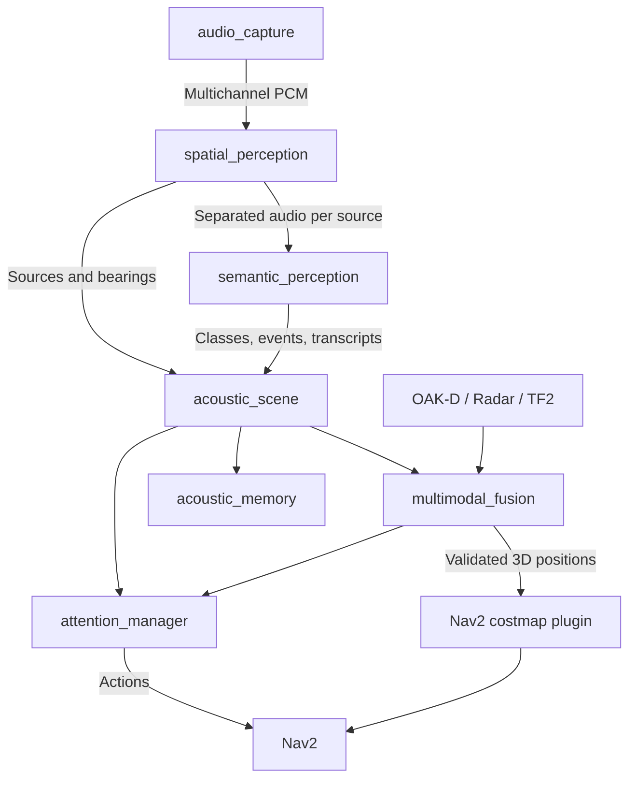

# audition_ros2

**ROS 2 acoustic perception built around the reusable [libaudition](https://github.com/ARDev1161/libaudition) C++ toolkit.**

This is the **documentation-only** branch. It explains the intended architecture, phased roadmap, configuration, interfaces and validation. The runtime source code is maintained in a separate development branch / [PR #1](https://github.com/ARDev1161/audition_ros2/pull/1).

## Interaction overview

The diagram is rendered directly from Mermaid so its layout and arrows match the reviewed source. [Edit the source diagram](diagrams/acoustic_interaction_flow.mmd).



The architecture uses **3 ROS nodes in M1**, **4 in M2**, **5 in M3**, up to **7 in M6**. The Nav2 costmap integration is a plugin of an existing server, not an extra ROS node. `acoustic_scene` is the canonical publisher of public source, event and transcript messages. No bearing-only result can become a metric source position.

## Documentation

```{toctree}
:maxdepth: 2
:caption: Design and architecture

ROADMAP
ROS2_ARCHITECTURE
LIBAUDITION_INTEGRATION
HUMAN_SPATIAL_HEARING
```

```{toctree}
:maxdepth: 2
:caption: Implementation and maintenance

M0_IMPLEMENTATION
M1_IMPLEMENTATION
site_build
```

## Current status

The implementation branch contains ROS message contracts, WAV replay, an isolated spatial adapter and a native ODAS integration tested on synthetic six-channel audio. **Live ALSA capture, measured ReSpeaker geometry, semantic inference, sensor fusion and navigation integration remain separate work.** This site does not present proposed YAML profiles as functional runtime configuration.
